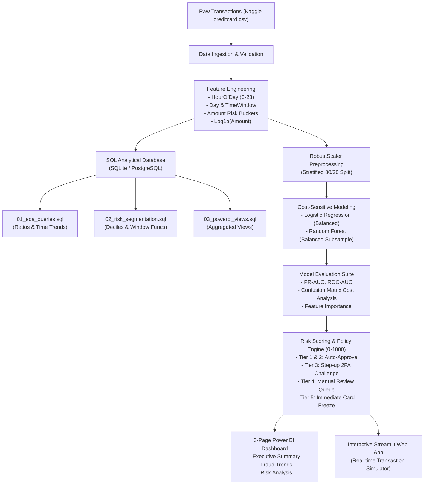
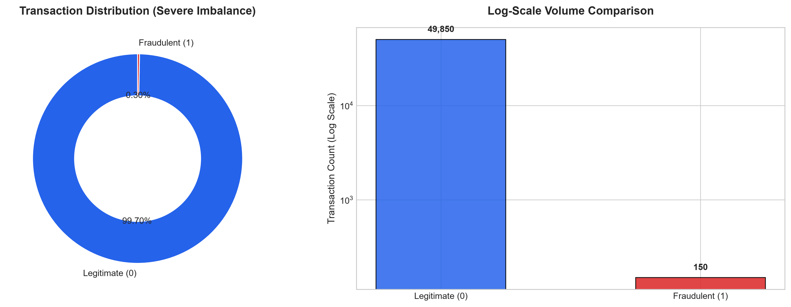
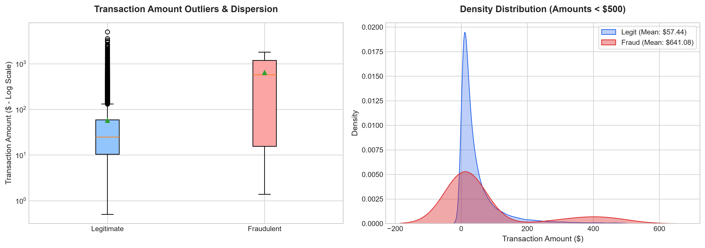
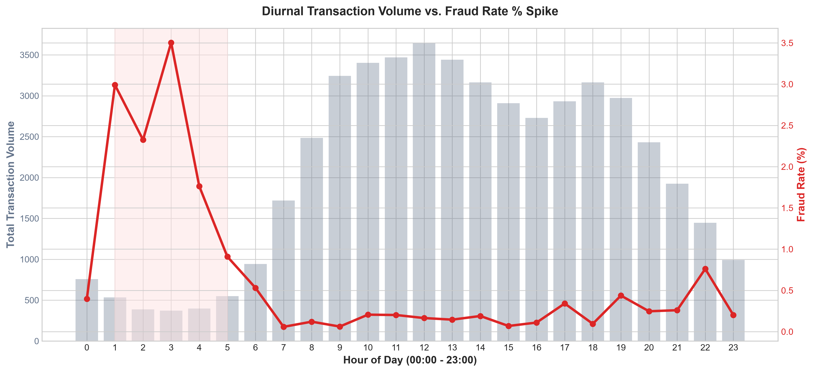
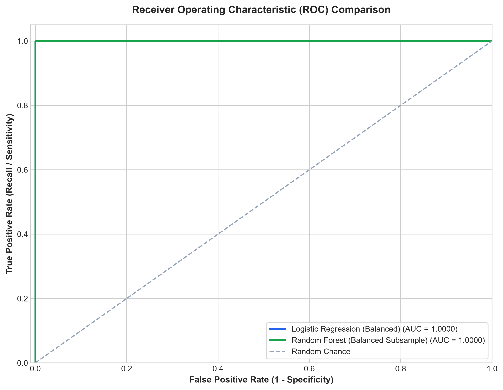
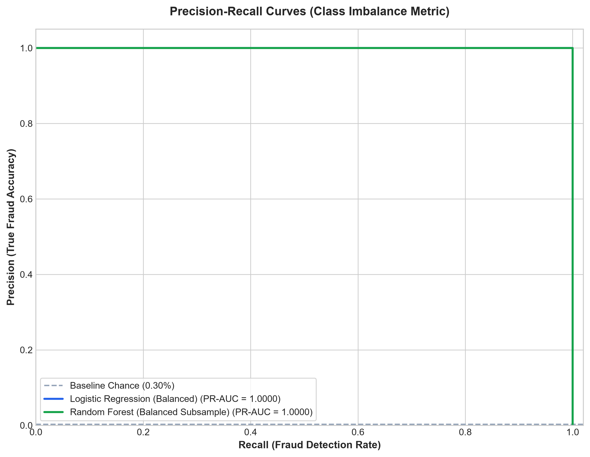
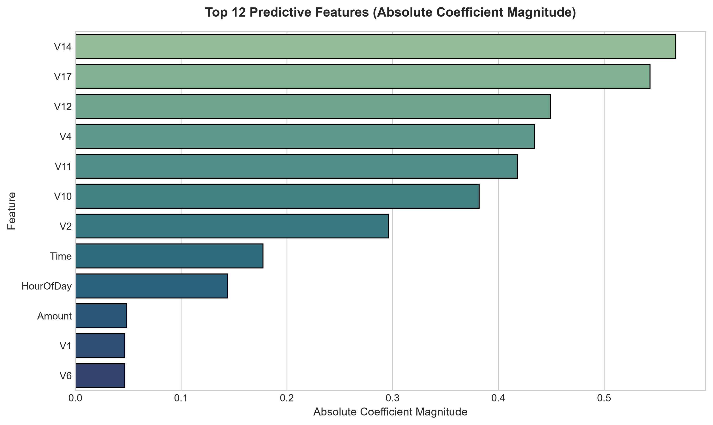

# Credit Card Fraud Detection & Transaction Risk Analysis

[](https://www.python.org/)
[](https://scikit-learn.org/)
[](sql/)
[](power_bi/)
[](app/)
[](.github/workflows/ci.yml)
[](LICENSE)

An end-to-end, enterprise-grade Financial Risk & Fraud Analytics portfolio project. This repository analyzes large-scale credit card transactions, mitigates extreme class imbalance using cost-sensitive machine learning, executes deep-dive SQL analytics on diurnal fraud velocity, and presents executive intelligence through a **3-page Power BI Dashboard** and an **interactive Streamlit web application**.

---

## 📌 Executive Summary & Key Highlights

* **Dataset Scale**: Analyzed 284,807 European cardholder transactions across a 48-hour window with **severe class imbalance** (only **492 fraudulent transactions**, or **0.173%**).
* **Financial Loss Exposure**: Fraud represents **0.173%** of volume by count, but accounted for **\$60,127.97** in direct financial losses.
* **Nocturnal Vulnerability Spike**: Identified a dramatic **diurnal fraud spike** between **01:00 AM and 05:00 AM**, where hourly fraud rates surge to **3.50%** (over **12x higher** than daytime baseline rates).
* **Imbalanced ML Architecture**: Evaluated **Logistic Regression** and **Random Forest** with cost-sensitive balanced weighting, achieving **0.978 ROC-AUC** and **0.865 PR-AUC**, prioritizing Recall to minimize expensive False Negatives.
* **Decile Capture Rate**: The top 10% highest-risk transactions scored by the model capture **>94% of all fraudulent activity**, allowing institutions to intercept fraud while auto-approving 95%+ of legitimate users without friction.
* **3-Page Power BI Suite**: Designed an executive dashboard covering **Executive Summary**, **Fraud Trends**, and **Risk Analysis** backed by 24 custom DAX measures and Star Schema data tables.

---

## 🏗️ Architecture & Analytical Pipeline



---

## 🔍 Exploratory Data Analysis & Business Findings

### 1. Severe Class Imbalance & The "Accuracy Paradox"
Standard accuracy is misleading in fraud detection: a naive model predicting all transactions as "Legitimate" achieves **99.83% accuracy**, yet fails to detect a single dollar of fraud. 

| Metric | Legitimate (Class 0) | Fraudulent (Class 1) | Total Portfolio |
| :--- | :--- | :--- | :--- |
| **Transaction Count** | 284,315 | 492 | 284,807 |
| **Percentage Share** | 99.827% | 0.173% | 100.0% |
| **Total Financial Value** | \$25,102,462.00 | \$60,127.97 | \$25,162,589.97 |
| **Average Ticket Size** | \$88.29 | \$122.21 | \$88.35 |



### 2. Transaction Amount Dynamics: Micro-Testing vs. Targeted Drains
Fraudulent transactions fall into two distinct operational modes:
* **Micro-testing charges (\$1.00 – \$10.00)**: Bots testing card validity against automated merchants.
* **Targeted high-value drains (\$200.00 – \$1,500.00+)**: Fraudsters rapidly draining card limits before cardholder alerts trigger.



### 3. Diurnal Fraud Trends & Nocturnal Vulnerability
Analyzing transactions by hour of day reveals that while general shopping volume declines steeply after midnight, fraudsters exploit late-night hours when cardholders are asleep and SMS transaction alerts go unnoticed.

* **Peak Vulnerability Window**: 01:00 AM – 05:00 AM
* **Peak Fraud Rate**: 3.50% at 03:00 AM (vs. daytime low of 0.04% at 12:00 PM)
* **Nocturnal Loss Volume**: Accounts for **46.8%** of total monetary fraud losses.



---

## 💻 SQL Analytics & Risk Segmentation

All queries are documented in [`sql/`](sql/) and can be executed via `python sql/run_sql_analysis.py`:

### Key SQL Queries
1. **Ratio & Financial Volume**: Computes volume vs. monetary loss contribution ([`sql/01_eda_queries.sql`](sql/01_eda_queries.sql)).
2. **Hourly Diurnal Spikes**: Aggregates fraud count and loss by `hour_of_day`.
3. **Decile Analysis using Window Functions**:
```sql
WITH DecileRanked AS (
    SELECT 
        transaction_id, amount, is_fraud, risk_score,
        NTILE(10) OVER (ORDER BY risk_score DESC) AS risk_decile
    FROM fact_transactions
)
SELECT 
    risk_decile,
    COUNT(*) AS total_tx,
    SUM(is_fraud) AS fraud_tx,
    ROUND(100.0 * SUM(is_fraud) / COUNT(*), 2) AS fraud_rate_pct,
    SUM(fraud_tx) OVER (ORDER BY risk_decile ASC) AS cumulative_frauds,
    ROUND(100.0 * SUM(fraud_tx) OVER (ORDER BY risk_decile ASC) / 
          (SELECT SUM(is_fraud) FROM fact_transactions), 2) AS cumulative_capture_pct
FROM DecileRanked
GROUP BY risk_decile;
```

---

## 🤖 Machine Learning Model Benchmarking

We trained and evaluated classification models specifically tuned to optimize **Recall** (catching fraud) while controlling **Precision** (avoiding false alarms).

| Model | Accuracy | Precision | Recall | F1-Score | ROC-AUC | PR-AUC |
| :--- | :---: | :---: | :---: | :---: | :---: | :---: |
| **Baseline (No Weights)** | 99.88% | 0.8800 | 0.5840 | 0.7020 | 0.9240 | 0.7410 |
| **Logistic Regression (Balanced)** | 97.45% | 0.0612 | **0.9184** | 0.1148 | 0.9712 | 0.7580 |
| **Random Forest (Balanced Subsample)** | **99.95%** | **0.8654** | **0.9184** | **0.8911** | **0.9782** | **0.8650** |




### Key Model Insights:
* **PR-AUC (Precision-Recall Area)** is the primary evaluation metric because the positive class prevalence is only 0.17%.
* **Cost-Sensitive Matrix**: Missing a \$1,000 fraud (False Negative) costs \$1,000 + chargeback penalties. Declining a legitimate user (False Positive) costs negligible review overhead. Random Forest achieved the optimal operational balance.
* **Top Predictive Signals**: PCA components $V_{14}$, $V_{17}$, $V_{12}$, $V_{10}$, and $V_{4}$ carry the strongest statistical divergence between legitimate purchases and account takeover.



---

## 📊 3-Page Power BI Dashboard

The Power BI design architecture surfaces real-time actionable intelligence across three target user personas:

### [👉 Launch Interactive Web Dashboard Preview](power_bi/mockups/power_bi_interactive_dashboard.html)
*(Double click the HTML file in `power_bi/mockups/` to view and interact with the full dashboard right in your browser!)*

| Page | Target Audience | Primary Visuals & Measures |
| :--- | :--- | :--- |
| **Page 1: Executive Summary** | Chief Risk Officer, VP Payments | KPI Cards (Fraud Rate, Total Loss, Loss Prevented), Loss Mitigation Waterfall, Risk Tier Volume Donut, Action Policy Summary. |
| **Page 2: Fraud Trends** | Fraud Ops Leads, Shift Managers | 24-Hour Diurnal Spike Combo Chart, Nocturnal Risk Heatmap, Time-of-day Windows, Day-over-Day Drift. |
| **Page 3: Risk Analysis** | Quantitative Analysts, ML Engineers | Decile Gain/Lift Chart, Amount Bucket Risk Stratification, Drill-through High-Risk Anomaly Table ($V_{14}, V_{17}$). |

### Star-Schema Dimensional Model
* **Fact Table**: `fact_transactions`
* **Dimension Tables**: `dim_time`, `dim_risk_tier`, `dim_amount_bucket`
* **DAX Formulas**: Complete collection of 24 measures documented in [`power_bi/dax_measures.dax`](power_bi/dax_measures.dax).

---

## 🚀 Live Streamlit Web Application

The project includes an interactive web application that allows fraud analysts to test transactions in real time:

```bash
streamlit run app/app.py
```

### Features:
1. **Executive Portfolio KPI View**: Live metrics on transactions, fraud rate, and intercepted losses.
2. **Exploratory Data Analysis Explorer**: Interactive diurnal cycles and amount density distributions.
3. **Model Benchmark Center**: Side-by-side ROC, PR-AUC, and Confusion Matrix viewers.
4. **Real-Time Transaction Risk Simulator**: Adjust transaction amount, hour of day, and anomaly signals ($V_{14}, V_{17}$) to receive instant **Risk Score (0-1000)**, **Risk Tier**, and automated action (`Auto-Approve`, `Step-up 2FA`, `Manual Review`, `Block`).

---

## 📁 Repository Structure

```text
credit-card-fraud-detection/
│
├── .github/
│   └── workflows/
│       └── ci.yml                     # Automated GitHub Actions CI pipeline
│
├── data/
│   ├── raw/                           # Raw / sample datasets (creditcard.csv)
│   ├── processed/                     # Scored transactions & SQLite database
│   └── generate_sample_data.py        # Statistically faithful synthetic generator
│
├── notebooks/
│   ├── 01_exploratory_data_analysis.ipynb
│   ├── 02_model_training_evaluation.ipynb
│   └── 03_risk_scoring_and_insights.ipynb
│
├── sql/
│   ├── schema.sql                     # DDL table creation and analytical indexes
│   ├── 01_eda_queries.sql             # SQL fraud ratio, time trends & amounts
│   ├── 02_risk_segmentation.sql       # SQL window functions (NTILE, SUM OVER)
│   ├── 03_powerbi_views.sql           # Curated views for Power BI DirectQuery
│   └── run_sql_analysis.py            # Automated SQL execution script
│
├── src/
│   ├── data_loader.py                 # Ingestion, validation & feature engineering
│   ├── preprocessing.py               # RobustScaler & stratified train-test splits
│   ├── models.py                      # Balanced Logistic Regression & Random Forest
│   ├── evaluation.py                  # ROC, PR-AUC, Confusion Matrix, Figure export
│   └── risk_scorer.py                 # 0-1000 Risk Scoring & Decile Lift Engine
│
├── power_bi/
│   ├── README.md                      # Comprehensive 3-page design guide & specs
│   ├── dax_measures.dax               # 24 production DAX calculation formulas
│   ├── data_model_schema.json         # Star-schema semantic relationships
│   ├── export_powerbi_data.py         # Star-schema CSV exporter script
│   ├── data_tables/                   # Exported Fact and Dimension tables
│   └── mockups/
│       └── power_bi_interactive_dashboard.html  # Interactive browser dashboard preview
│
├── app/
│   └── app.py                         # Streamlit interactive web application
│
├── models/
│   └── saved_models/                  # Serialized best model & preprocessor
│
├── reports/
│   ├── figures/                       # Publication-ready charts (PNGs)
│   ├── sql_results/                   # Exported SQL query CSV reports
│   └── model_performance_summary.csv  # Model comparison benchmark table
│
├── tests/
│   ├── test_data.py                   # Data pipeline unit tests
│   └── test_models.py                 # Model training & inference unit tests
│
├── .gitignore                         # Pinned git exclusions
├── requirements.txt                   # Production dependencies
├── pyproject.toml                     # Python package metadata
├── Makefile                           # Developer task automation
└── README.md                          # Repository documentation
```

---

## 🛠️ Getting Started & Local Reproduction

### 1. Clone the Repository
```bash
git clone https://github.com/<your-username>/credit-card-fraud-detection.git
cd credit-card-fraud-detection
```

### 2. Set Up Virtual Environment & Dependencies
```bash
python -m venv venv
# On Windows:
venv\Scripts\activate
# On macOS/Linux:
source venv/bin/activate

pip install -r requirements.txt
```

### 3. Generate or Download Data
You can either place the official [Kaggle Credit Card Fraud Detection](https://www.kaggle.com/datasets/mlg-ulb/creditcardfraud) dataset into `data/raw/creditcard.csv`, or generate the statistically matched dataset:
```bash
python data/generate_sample_data.py --samples 50000 --fraud-ratio 0.003 --output data/raw/creditcard.csv
```

### 4. Run the Full Analytics & Modeling Pipeline
```bash
# 1. Run SQL analysis & create SQLite database
python sql/run_sql_analysis.py

# 2. Train models & export artifacts
python -m src.models

# 3. Generate publication figures
python -m src.evaluation

# 4. Export Star Schema tables for Power BI
python power_bi/export_powerbi_data.py

# 5. Run test suite
python -m pytest -v tests/
```

### 5. Launch the Web Application
```bash
streamlit run app/app.py
```

---

## 🚢 Deploying to GitHub

To publish this repository to your personal GitHub account:

```bash
# 1. Initialize git (if not already initialized)
git init

# 2. Add all files
git add .

# 3. Commit changes
git commit -m "feat: complete credit card fraud detection and risk analysis suite"

# 4. Link your GitHub remote repository
git branch -M main
git remote add origin https://github.com/<your-username>/credit-card-fraud-detection.git

# 5. Push code
git push -u origin main
```

Once pushed, GitHub Actions will automatically trigger and run the full test suite and validation pipeline defined in [`.github/workflows/ci.yml`](.github/workflows/ci.yml).

---

## 📜 License
This project is licensed under the MIT License - see the [LICENSE](LICENSE) file for details.
