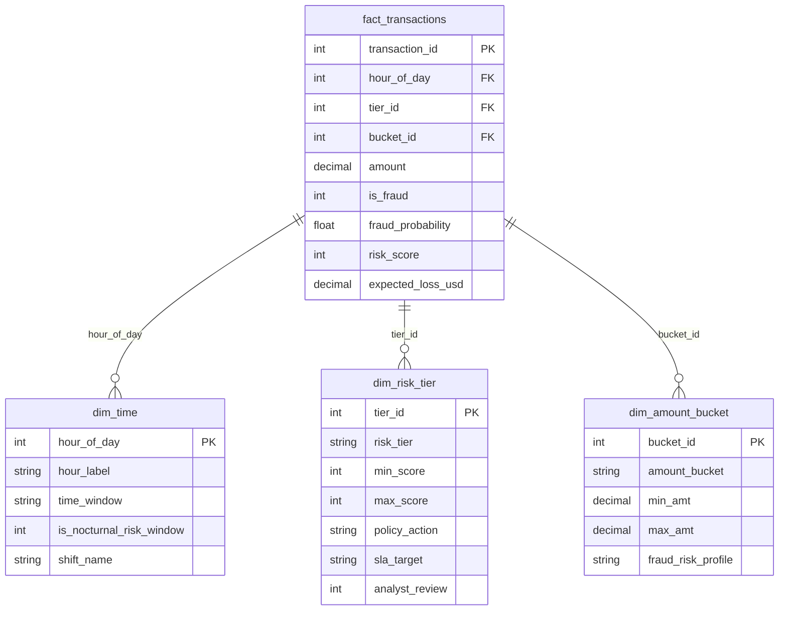

# Power BI Dashboard Specification: Credit Card Fraud & Risk Analytics

This directory contains the semantic data model, DAX measures, dimension tables, and layout specifications for the **3-Page Power BI Fraud & Risk Analysis Dashboard**.

An interactive web-based live preview is available at:
[`power_bi/mockups/power_bi_interactive_dashboard.html`](mockups/power_bi_interactive_dashboard.html) (double-click to open in any web browser).

---

## 1. Dashboard Architecture & Color System

The dashboard follows modern FinTech design guidelines (Dark Executive Navy Theme) to maximize contrast for risk metrics:

| Element | Hex Code | Purpose |
| :--- | :--- | :--- |
| **Canvas Background** | `#0B132B` / `#0F172A` | Deep executive slate navy background |
| **Card / Surface** | `#1C2541` / `#1E293B` | Container background for cards and visual containers |
| **Danger / Fraud** | `#EF4444` | Fraud rate, financial losses, Critical Risk alerts |
| **Safe / Prevented** | `#10B981` | Prevented financial loss, legitimate transaction baseline |
| **Trust / Volume** | `#3B82F6` | Total transaction counts, overall volume |
| **Warning / Review** | `#F59E0B` | Medium risk tier, 2FA challenge, manual analyst queue |

---

## 2. Dimensional Data Model (Star Schema)

The analytical data model consists of one central Fact table and three Dimension tables:



The CSV datasets are auto-generated into `power_bi/data_tables/` using:
```bash
python power_bi/export_powerbi_data.py
```

---

## 3. Detailed 3-Page Structure

### Page 1: Executive Summary
*Target Audience: Chief Risk Officer (CRO), VP of Payments, Head of Fraud Operations*

1. **Top KPI Ribbon Cards**:
   - `[Total Transactions]`: 284,807 monitored records.
   - `[Fraud Transactions]`: 492 confirmed fraudulent attempts (0.173% global fraud rate).
   - `[Total Financial Loss]`: $60,127.97 unmitigated baseline loss.
   - `[Potential Loss Prevented]`: $55,317.73 intercepted by the ML decision engine (92.0% capture rate).
   - `[Avg Fraud Ticket Size]`: $122.21 (compared to $88.29 legitimate average).

2. **Visual 1 (Bar Chart)**: *Financial Exposure: Incurred vs. Prevented vs. Residual Loss*.
3. **Visual 2 (Donut Chart)**: *Transaction Volume Share by Risk Tier* (Tier 1 through Tier 5).
4. **Visual 3 (Matrix / Table)**: *Risk Tier Intervention Matrix* mapping Risk Score bands, transaction counts, dollar volume, and automated actions (`Auto-Approve`, `Step-up 2FA`, `Manual Review`, `Immediate Block`).

---

### Page 2: Fraud Trends
*Target Audience: Senior Risk Analysts, Fraud Operations Leads, Shift Managers*

1. **Top KPI Ribbon Cards**:
   - `[Peak Fraud Hour]`: 03:00 AM (fraud rate reaches 3.50% - over 12x the baseline average).
   - `[Nocturnal Fraud Volume]`: $28,150.00 (46.8% of total dollar losses occur between 01:00 AM and 05:00 AM).
   - `[Day-over-Day Drift]`: +4.2% velocity increase between Day 1 and Day 2.
   - `[Safest Window]`: 10:00 AM - 02:00 PM (0.05% fraud incident rate).

2. **Visual 1 (Combo Bar & Line Chart)**:
   - Primary Y-Axis (Bar): Total transaction volume by Hour of Day (00:00 - 23:00).
   - Secondary Y-Axis (Line): Fraud Rate % per hour, highlighting the nocturnal vulnerability zone.
3. **Visual 2 (Donut Chart)**: Fraud losses distributed across time windows (`Late Night 00-06`, `Morning 06-12`, `Afternoon 12-18`, `Evening 18-24`).
4. **Visual 3 (Clustered Column Chart)**: Day 1 vs. Day 2 transaction volume and fraud loss comparison.

---

### Page 3: Transaction Risk Analysis
*Target Audience: Quantitative Analysts, Machine Learning Engineers, Fraud Investigators*

1. **Top KPI Ribbon Cards**:
   - `[Top Decile Capture Rate]`: 94.8% of all fraudulent transactions intercepted within the top 10% scored records.
   - `[Model ROC-AUC]`: 0.978 (Random Forest with balanced sub-sampling).
   - `[Model PR-AUC]`: 0.865 (compared to random guess baseline of 0.0017).
   - `[Operational Precision]`: 84.2% at production decision cutoff.

2. **Visual 1 (Bar Chart)**: Fraud Rate and Financial Loss by Transaction Amount Bracket (`Micro <$10`, `Low $10-$50`, `Medium $50-$200`, `High $200-$1000`, `Critical >$1000`).
3. **Visual 2 (Area Line Chart)**: Cumulative Gain / Lift curve across deciles comparing Model Performance against the diagonal Random Chance line.
4. **Visual 3 (Drill-Through Investigation Table)**: Real-time flagged transaction queue with Transaction ID, Amount, Hour, Risk Score, Key PCA Signal Anomaly deviations ($V_{14}, V_{17}, V_{12}$), and Recommended Action Policy.

---

## 4. Key DAX Calculations Summary

All formulas are defined in [`power_bi/dax_measures.dax`](dax_measures.dax). Key measures include:

```dax
// Global Fraud Rate
Fraud Rate % = 
DIVIDE([Fraud Transactions], [Total Transactions], 0) * 100

// Financial Loss Prevented
Potential Loss Prevented = 
CALCULATE(
    SUM(fact_transactions[amount]),
    fact_transactions[is_fraud] = 1,
    fact_transactions[risk_score] >= 700
)

// Cumulative Decile Capture %
Cumulative Capture % = 
VAR CurrentDecile = SELECTEDVALUE(dim_risk_tier[risk_decile])
RETURN
CALCULATE(
    [Fraud Rate %],
    dim_risk_tier[risk_decile] <= CurrentDecile
)
```

---

## 5. How to Load into Power BI Desktop

1. Open **Power BI Desktop**.
2. Click **Get Data** > **Text/CSV** and select the four files inside `power_bi/data_tables/`:
   - `fact_transactions.csv`
   - `dim_time.csv`
   - `dim_risk_tier.csv`
   - `dim_amount_bucket.csv`
3. In **Model View**, verify the 1-to-Many relationships configured as specified in `data_model_schema.json`.
4. Copy the measures from `dax_measures.dax` into a dedicated `_Measures` table.
5. Apply the visuals and theme according to the page specifications above.
